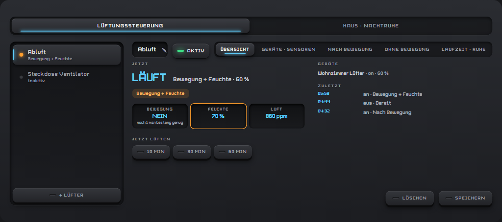

# Ventilation Control

Fan control per room for Home Assistant: fans run after motion, on high humidity or poor air quality, or at intervals – with run-on, minimum and maximum run time, window lock, quiet hours and manual override.


*Ventilation tab in the [Room Panel card](https://github.com/SysriX/room_panel_ha_card): fan running because of motion + humidity, live sensor values and recent switching (UI in German)*

Integration domain: `vent_control`  
Version: 1.2.0  
UI language of the built-in texts (reasons, names): German

> Built for the author's own home. It works with any fans and sensors; the fallback for motion/presence sensors uses helper entities from the author's motion-lighting setup (see [Optional helper entities](#optional-helper-entities)). Room ids may need adapting.

## Features

- Up to 6 fan units per room. A unit is one or more devices (`fan`, `switch`, `light`, `input_boolean`) switched together; for `fan` devices a speed (percentage) can be set per rule – the highest active speed wins.
- **After motion**
  - *Timer*: X min after the start (or end) of motion for Y min, optionally restarting
  - *Minimum presence*: only after continuous motion/presence for X min (with a tolerated gap), then immediately or after the timer delay
  - *Humidity / air quality*: above the on-threshold while there is motion or up to Z min after it; runs until the value drops below the off-threshold
- **Without motion**: humidity and air quality (CO₂, VOC, particulate matter … – highest value counts) with their own thresholds, interval every X h for Y min.
- **Run time**: run-on after humidity/air rules, minimum run time, maximum run time with pause.
- **Locks**: open window → off (with delay), house-wide quiet hours (humidity may still ventilate, per unit), manual switching pauses the automation for X min.
- **Master switch** for the whole house.
- Switching actions fire the event `vent_control_changed`.

## Entities

| Entity | Description |
| --- | --- |
| `sensor.<room>_vent_control` | `on` (a fan is running) / `idle` / `off` (no active unit or master switch off); attribute `units` = all units with state, reasons and devices |
| `sensor.haus_vent_control` | Master switch `on` / `off`; attributes: house settings (quiet hours) |

## Services

| Service | Description |
| --- | --- |
| `vent_control.set_enabled` | Enable or disable the automation of a unit (`unit_id`, `enabled`) |
| `vent_control.run` | Run a unit now for `minutes` (automation paused meanwhile; 0 = back to automation) |
| `vent_control.set_master` | House-wide master switch (`enabled`) |

Unit IDs are in the `units` attribute of `sensor.<room>_vent_control`. A WebSocket API (`vent_control/save`, `delete`, `house`, `run`) is used by the companion card.

## Requirements

- Home Assistant 2024.6 or newer
- Recommended: the companion card for configuration (there is no config flow / options UI)

## Installation

### HACS (custom repository)

1. HACS → three-dot menu → **Custom repositories**
2. Repository `https://github.com/SysriX/vent_control_ha_integration`, category **Integration**
3. Install **Ventilation Control** and restart Home Assistant

### Manual

Copy `custom_components/vent_control` into `<config>/custom_components/` and restart Home Assistant.

## Configuration

YAML only (no config flow). Add to `configuration.yaml` and restart:

```yaml
vent_control:
  rooms: [wz, bu, ku, sz, fl, ke, ba, bz]   # optional, this is the default
```

`rooms` is a list of short room ids (slugs); one sensor is created per room. The defaults are the author's German room abbreviations – use your own. Settings are stored in `.storage/vent_control`. New units are created disabled.

### Optional helper entities

If a unit has no motion sensors of its own, the motion sensors of the room's motion lighting are used:

| Helper | Purpose |
| --- | --- |
| `input_text.<room>_light_motion_cfg_motion_sensors` | Motion sensors of the room, comma-separated entity ids (fallback when none are selected) |
| `input_text.<room>_light_motion_cfg_presence_sensors` | Presence sensors of the room (used when "presence from light control" is enabled) |

Simply select the sensors in the unit if you don't have these helpers.

## Companion card

[room_panel_ha_card](https://github.com/SysriX/room_panel_ha_card) (`custom:raum-panel`) – settings → ventilation control.

## License

MIT – see [LICENSE](LICENSE).
